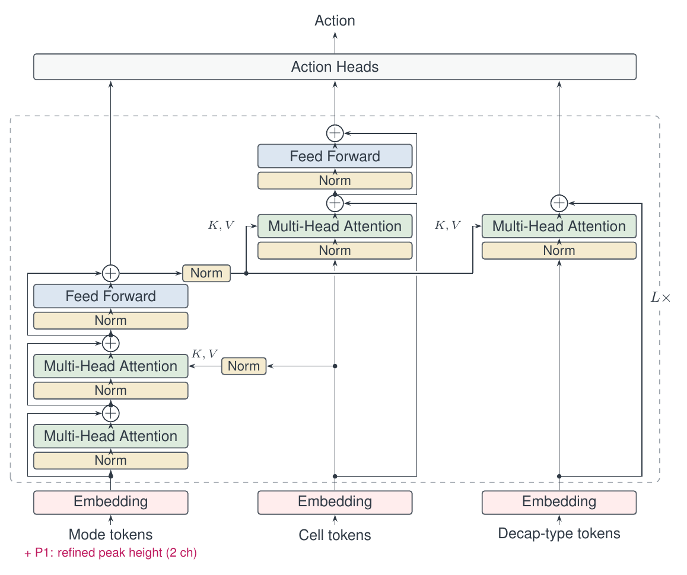
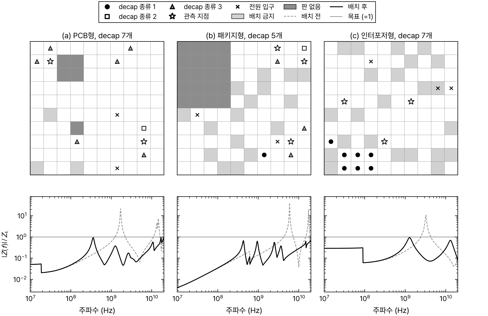
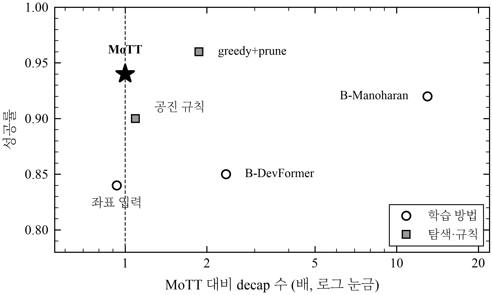
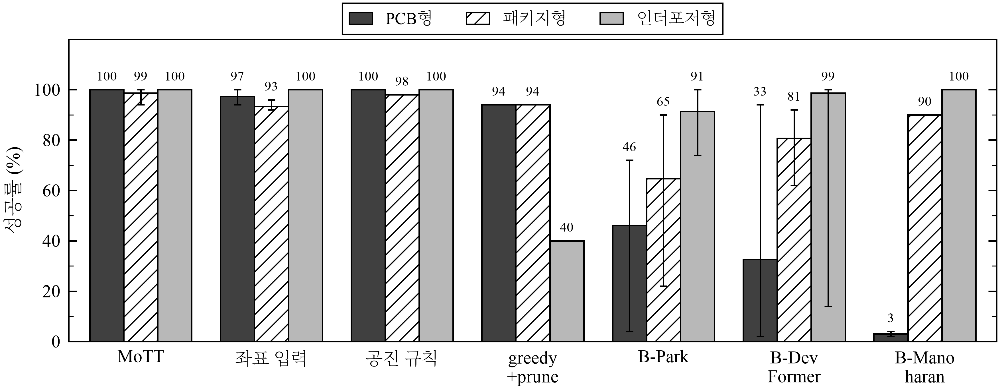
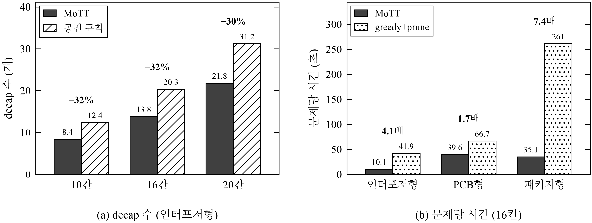

<div align="center">

# MoTT: Modal-Token Transformer

**Decap 배치 범용화를 위한 모달 토큰 트랜스포머**

A Modal-Token Transformer for Generalizable Decoupling Capacitor Placement

한국어 | [English](README_en.md)



</div>

## 소개

반도체에 전력을 공급하는 전원 분배망(PDN)은 특정 주파수에서 공진하여 임피던스가 커진다. 디커플링 커패시터(decap)를 알맞은 위치에 놓으면 이 피크를 낮출 수 있지만, 어디에 어떤 종류를 놓을지는 조합이 너무 많아 모두 따져 볼 수 없다.

강화학습으로 배치를 빠르게 정하는 선행 연구는 주로 칸의 좌표를 입력으로 쓴다. 이렇게 학습한 정책은 판의 종류(PCB, 패키지, 인터포저)가 바뀌면 다시 학습해야 한다. MoTT는 판을 좌표 대신 공진 모드, 칸, decap 종류의 토큰으로 나타내어, 학습에서 보지 못한 종류와 크기의 판에도 재학습 없이 쓸 수 있게 한 정책이다.

이 저장소에는 시뮬레이터, 모델과 학습 코드, 비교 방법, 그리고 보고서의 모든 수치가 나온 평가 기록이 들어 있다.

<div align="center">


세 종류의 판(10×10)에 MoTT가 decap을 배치한 결과. 아래는 배치 전(점선)과 후(실선)의 임피던스.
</div>

## 수치 확인 방법

| 확인하려는 것 | 볼 곳 |
|:--|:--|
| 표의 숫자가 어디서 나왔나 | [`runs/`](runs) 평가 기록 ([형식](runs/README.md), [전체 집계](docs/RESULTS.md)) |
| 판정 규칙을 결과보다 먼저 정했나 | [사전 등록 타임라인](docs/PREREGISTRATION.md) (실험별 규칙 커밋과 첫 결과 커밋) |
| 판정 규칙의 내용 | [docs/PROPOSALS.md](docs/PROPOSALS.md) |
| 정리 전 전체 기록 | [`research-log`](../../tree/research-log) 브랜치, [`experiments-final`](../../tree/experiments-final) 태그 |

각 실험 끝의 **기록** 줄에서 해당 폴더와 커밋으로 바로 갈 수 있다.

## 실험과 결과

성공률은 정밀 검사(700개 주파수와 피크 주변)를 통과한 문제의 비율이다. 따로 적지 않으면 10×10 판, seed 3개 × 50문제이다. 모든 방법을 같은 문제와 같은 검사로 평가하였다.

### 1. 입력 분석: 어떤 입력이 판의 종류를 넘어 통하는가

학습 전에, 한 종류의 판에서 좋은 위치를 가려내던 입력이 다른 종류에서도 통하는지 AUC로 확인하였다(0.5가 무작위 수준).

| 입력 | PCB → PCB | PCB → 인터포저 | 인터포저 → PCB |
|:--|:-:|:-:|:-:|
| 관측 지점까지의 거리 | 0.74 | 0.46 | 0.23 |
| 루프 인덕턴스 + 고정 주파수 임피던스 | 0.88 | 0.45 | 0.59 |
| decap 하나를 놓았을 때의 효과 | 0.73 | 0.98 | 0.74 |
| 공진 정보 | 0.86 | 0.59 | 0.32 |

선행 연구에서 쓰는 입력은 판의 종류가 바뀌면 무작위 수준 아래로 떨어졌다. 그래서 종류를 넘어 유지되는 "decap 하나의 효과"를 기본 점수로 쓰고, 공진 정보는 보정으로만 쓰도록 모델을 설계하였다.

> **기록** 분석 코드와 결과는 [`research-log` 브랜치](../../tree/research-log/research_notes/%ED%86%A0%ED%81%B0%20%EB%8D%B0%EC%9D%B4%ED%84%B0%20%EB%B6%84%EC%84%9D)에 있다.

### 2. 처음 보는 종류의 판

세 종류 중 하나를 학습에서 완전히 빼고, 뺀 종류에서 평가하였다.

| 제외한 종류 | MoTT | 좌표 입력 모델 |
|:--|:-:|:-:|
| PCB형 | 0.89 | 0.64 |
| 인터포저형 | 0.99 | 0.65 |
| 패키지형 | 0.71 | 0.80 |
| 패키지형 + 검증 하네스 | 0.99 | 0.92 |

정책만으로는 패키지형에서 좌표 입력 모델보다 낮았다. 원인은 계산에 쓰는 32개 주파수 사이에 숨은 피크였고, 정밀 검사로 실패 주파수를 찾아 다시 고치게 하는 검증 하네스를 더하자 실패한 44문제 중 43문제가 decap을 늘리지 않고 풀렸다.

같은 하네스를 선행 연구 재구현에도 적용한 결과(패키지형을 제외하고 학습):

| 방법 | 패키지형 (처음 보는 종류) | PCB형 | 인터포저형 | MoTT 대비 decap 수 |
|:--|:-:|:-:|:-:|:-:|
| MoTT | 0.99 | 0.99 | 1.00 | – |
| 좌표 입력 | 0.92 | 0.94 | 1.00 | 1.0배 |
| B-Park | 0.91 | 0.04 | 1.00 | 2.8배 |
| B-DevFormer | 0.45 | 0.79 | 0.99 | 4.5배 |
| B-Manoharan | 0.89 | 0.03 | 1.00 | 4.3배 |

> **기록** [`runs/2026-10-29/`](runs/2026-10-29) 의 `lo_<종류>_r2pk*_rl`(MoTT), `lo_<종류>_r0*_rl`(좌표 입력), `lo_pkg_bp_park*`·`lo_pkg_bdf*`·`lo_pkg_bm2_rlonly*`(재구현). 하네스 결과는 파일 이름이 `+rep4`로 끝난다. · 판정 규칙: F1 [`ed4ced5`](https://github.com/jeehoo0507/R2E/commit/ed4ced5), N [`ce4422f`](https://github.com/jeehoo0507/R2E/commit/ce4422f), 패키지형 하네스(결과를 본 뒤 추가) [`451ec4d`](https://github.com/jeehoo0507/R2E/commit/451ec4d)

### 3. 처음 보는 크기의 판

8–12칸 판으로 학습한 모델을 16×16과 20×20에서 평가하였다.

| 크기 | 종류 | 정책 | + 검증 하네스 |
|:--|:--|:-:|:-:|
| 16×16 | 인터포저형 | 1.00 | 1.00 |
| | PCB형 | 0.92 | 0.99 |
| | 패키지형 | 0.56 | 0.94 |
| 20×20 | 인터포저형 | 1.00 | 1.00 |
| | PCB형 | 0.92 | 1.00 |
| | 패키지형 | 0.50 | 0.96 |

<div align="center">


가장 어려운 패키지형 16×16에서의 성공률과 decap 수(하네스 적용).
</div>

> **기록** [`runs/2026-10-29/`](runs/2026-10-29) 의 `r2pk*_rl/eval/eval_<종류>16_*`, `eval_<종류>20_*` · 판정 규칙: F [`0242e56`](https://github.com/jeehoo0507/R2E/commit/0242e56)

### 4. 입력과 구조의 단계별 효과

| 모델 | 입력 | 구조 | 처음 보는 PCB형 | 처음 보는 인터포저형 | decap 수 (인터포저형 10칸 / 16칸) |
|:--|:--|:--|:-:|:-:|:-:|
| 좌표 입력 | 좌표 | 기본 | 0.64 | 0.65 | 11.2 / 20.6 |
| 공진 입력 | 좌표 + 공진 | 기본 | 0.84 | 0.89 | 9.8 / 17.9 |
| MoTT (P1 제외) | 공진 | MoTT | 0.90 | 0.89 | 8.0 / 14.6 |
| MoTT | 공진 + P1 | MoTT | 0.89 | 0.99 | 8.0 / 13.9 |

공진 정보를 입력에 넣으면 처음 보는 종류의 성공률이 올랐고, 구조를 MoTT로 바꾸면 decap 수가 줄었다.

> **기록** `r0_coord*`(좌표 입력), `r1_modal*`(공진 입력), `r2_mott*`(P1 제외), `r2pk*`(MoTT)와 각각의 `lo_<종류>_*` · 판정 규칙: P1 [`4b496a5`](https://github.com/jeehoo0507/R2E/commit/4b496a5)

### 5. 세 종류를 모두 학습한 경우

<div align="center">

</div>

세 종류 모두에서 0.99 이상인 학습 방법은 MoTT뿐이었다. 선행 연구 재구현은 seed에 따라 PCB형 성공률이 0.02까지 떨어졌다.

> **기록** [`runs/2026-10-29/`](runs/2026-10-29) 의 `r2pk*`, `r0_coord*`, `bp_park*`, `bdf*`, `bm2_rlonly*` · 판정 규칙: B1 [`e70de68`](https://github.com/jeehoo0507/R2E/commit/e70de68), N [`ce4422f`](https://github.com/jeehoo0507/R2E/commit/ce4422f)

### 6. decap 수와 속도

<div align="center">

</div>

인터포저형에서 공진 규칙보다 decap을 약 30% 적게 썼다(10/16/20칸에서 8.4/13.8/21.8개, 공진 규칙 12.4/20.3/31.2개).

속도는 문제 세트를 바꿔 세 번 측정하였다. 하네스를 포함한 전체 시간 기준으로 greedy+prune이 MoTT의 몇 배 걸렸는지:

| 측정 | 인터포저형 | PCB형 | 패키지형 |
|:--|:-:|:-:|:-:|
| 1차 (50문제) | 4.1배 | 1.7배 | 7.4배 |
| 2차 (150문제) | 4.4배 | 1.4배 | 4.3배 |
| 3차 (150문제, 다른 서버) | 3.9배 | 1.7배 | 6.0배 |

1차와 2차의 기록은 `runs/speed_*`에 있다. 3차(서버 2)의 기록은 추가할 예정이다.

> **기록** [`runs/speed_1109u/`](runs/speed_1109u), `runs/speed_1110v_*/` · 측정 조건: [docs/PROPOSALS.md](docs/PROPOSALS.md)의 11/09 U, 11/10 V

## 실행

```bash
pip install -r requirements.txt
python sanity_check.py                                  # 시뮬레이터와 정밀 검사 확인

python scripts/build_pools.py --out runs/pool_v1        # 문제 생성 (고정 seed)
python scripts/make_teacher.py --pool runs/pool_v1 --out data/teacher

# 학습: 교사 해 모방 0.75 h → 강화학습 1.25 h
python scripts/run_rung.py --name r2pk --arm "--model mott --peak_refine" \
    --distill_hours 0.75 --rl_hours 1.25 --seed 0

# 평가: --repair 4 가 검증 하네스
python scripts/eval_policy.py --pool runs/pool_v1 --sets 'eval_*' \
    --policy mott=runs/<day>/r2pk_rl/best.pt --repair 4 --out runs/<day>/r2pk_rl
```

## 저장소 구성

| 경로 | 내용 |
|:--|:--|
| `decap_loop/` | PDN 시뮬레이터, 정밀 검사, MoTT 모델, 탐색 방법 |
| `baselines_ml/` | 선행 연구 재구현 (B-Park, B-DevFormer, B-Manoharan) |
| `train.py`, `scripts/` | 학습, 문제 생성, 평가, 결과 집계, 속도 측정 |
| `runs/` | 평가 기록. 위의 모든 수치가 여기서 나온다 ([형식](runs/README.md)) |
| `docs/` | 판정 규칙 기록, 사전 등록 타임라인, 결과 집계, 에이전트 운영 문서 |

## 비교한 선행 연구

B-로 시작하는 방법은 아래 논문의 구조와 입력을 이 저장소의 문제에 맞게 옮긴 재구현이다. 문제 설정과 학습 예산(2시간)이 원 논문과 다르므로 원 논문의 성능을 재현한 것은 아니다.

- Park et al., "Transformer network-based reinforcement learning method for PDN optimization of HBM," IEEE T-MTT, 2022. [doi](https://doi.org/10.1109/TMTT.2022.3202221)
- Kim et al., "DevFormer: A symmetric transformer for context-aware device placement," ICML, 2023. [paper](https://proceedings.mlr.press/v202/kim23h.html)
- Manoharan et al., "Reinforcement learning for decoupling capacitor optimization in postlayout PDNs using transformer architecture," IEEE T-SIPI, 2026. [doi](https://doi.org/10.1109/TSIPI.2026.3691276)

## 한계

합성 판에서만 검증하였고, 최대 20×20 판과 종류마다 decap 3종 규모이다.
