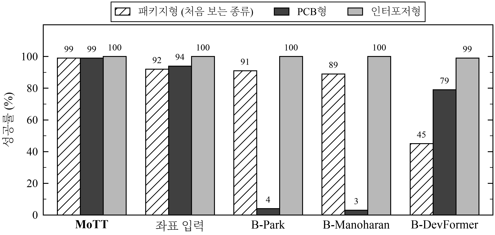
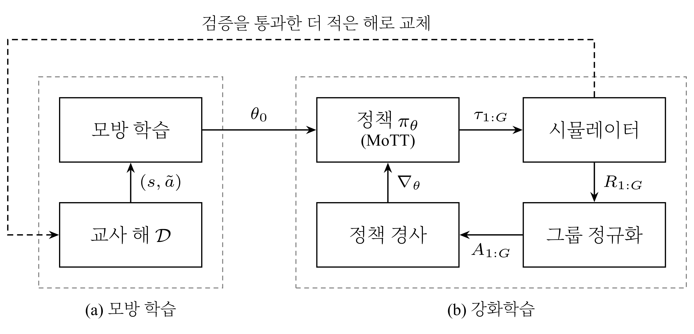
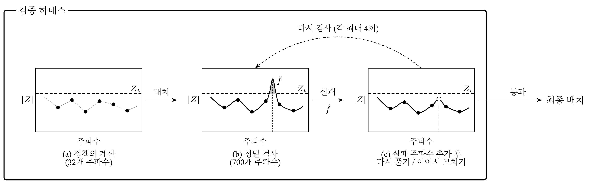

<div align="center">

# MoTT: Modal-Token Transformer

<b>Decap 배치 범용화를 위한 모달 토큰 트랜스포머</b>

A Modal-Token Transformer for Generalizable Decoupling Capacitor Placement

한국어 | [English](README_en.md) · [보고서 PDF](paper/MoTT_report.pdf)

[소개](#소개) · [방법](#방법) · [주요 결과](#주요-결과) · [실험](#실험) · [실행](#실행) · [수치 확인 방법](#수치-확인-방법)


</div>

## 소개

전원 분배망(PDN)은 특정 주파수에서 공진하여 임피던스가 커진다. 디커플링 커패시터(decap)를 알맞은 칸에 놓으면 이 피크를 낮출 수 있지만, 칸과 종류의 조합이 너무 많아 모두 따져 볼 수는 없다.

강화학습으로 배치를 빠르게 정하는 선행 연구는 주로 칸의 좌표를 입력으로 쓰며, 판의 종류(PCB, 패키지, 인터포저)가 바뀌면 다시 학습해야 한다. MoTT는 판을 좌표 대신 <b>공진 모드, 칸, decap 종류의 토큰</b>으로 나타내어, 학습에서 보지 못한 종류와 크기의 판에도 재학습 없이 쓸 수 있다.

처음 보는 종류의 판에서 MoTT는 <b>PCB형 89%, 인터포저형 99%</b>를 풀어 좌표 입력 모델(64%, 65%)보다 높았다. 검증 하네스를 더하면 처음 보는 패키지형에서 <b>99%</b>, 학습하지 않은 16×16·20×20 판에서 <b>94% 이상</b>을 풀었고, 선행 연구 재구현과 비교해 세 종류를 모두 99% 이상 푼 유일한 방법이었다. decap은 인터포저형에서 공진 규칙보다 약 30% 적게 썼다.

<div align="center">


<sub>패키지형을 제외하고 학습한 모델의 성공률 (10×10, seed 3개 × 50문제, 하네스 적용). B-는 선행 연구를 같은 문제와 같은 학습 예산으로 옮긴 재구현</sub>
</div>

<div align="center">


<sub>세 종류의 판(10×10)에 MoTT가 decap을 배치한 결과. 아래: 배치 전(점선)과 후(실선)의 임피던스</sub>
</div>

## 방법

<b>입력.</b> 판을 세 종류의 토큰으로 나타낸다. 모드 토큰은 가장 높은 공진 피크 8개의 주파수와 높이를, 칸 토큰은 그 칸에 decap 하나를 놓았을 때의 정확한 효과를, decap 토큰은 종류별 특성을 담는다. 좌표는 쓰지 않는다.

<b>모델.</b> 칸끼리는 직접 attention하지 않고 모드 토큰을 거쳐서만 정보를 주고받는다. 실제 판에서 칸들이 공진 모드를 통해 서로 영향을 주는 것을 그대로 옮긴 구조이며, 계산량이 칸 수의 제곱이 아니라 칸 수 × 모드 수에 비례한다. 출력 점수는 정확히 계산한 1수 효과에 학습한 보정을 더한 값이다.

<b>학습.</b> 탐색으로 구한 교사 해를 모방한 뒤(0.75시간) 강화학습으로 다듬는다(1.25시간). 판마다 배치 8개를 샘플링하여 같은 판 안에서 정규화한 이점으로 정책을 갱신하고, 정밀 검사를 통과하면서 decap이 더 적은 해가 나오면 교사 해를 그 해로 바꾼다.

<div align="center">


<sub>학습 과정. (a) 모방 학습, (b) 강화학습</sub>
</div>

<b>검증 하네스.</b> 정책은 32개 주파수만 보고 배치하므로 그 사이의 피크를 놓칠 수 있다. 배치를 정밀 검사로 확인하고, 실패한 주파수를 입력에 더해 다시 풀거나 이어서 고치게 한다.

<div align="center">

</div>

## 주요 결과

| 질문 | 결과 |
|:--|:--|
| 처음 보는 종류의 판에서도 푸는가 | PCB형 0.89, 인터포저형 0.99 (좌표 입력 모델 0.64, 0.65). 패키지형은 검증 하네스를 더해 0.99 |
| 처음 보는 크기의 판에서도 푸는가 | 16×16, 20×20에서 세 종류 모두 0.94 이상 (하네스 적용) |
| decap을 적게 쓰는가 | 인터포저형에서 공진 규칙보다 약 30% 적음 |
| 탐색보다 빠른가 | greedy+prune보다 인터포저형 약 4배, 패키지형 4–7배, PCB형 약 1.5배 |

성공률은 정밀 검사(700개 주파수와 피크 주변)를 통과한 문제의 비율이다. 모든 방법을 같은 문제와 같은 검사로 평가하였다.

## 실험

따로 적지 않으면 10×10 판, seed 3개 × 50문제이다.

### 1. 입력 분석

한 종류의 판에서 좋은 위치를 가려내던 입력이 다른 종류에서도 통하는지, 학습 전에 AUC로 확인하였다(0.5가 무작위 수준).

| 입력 | PCB → PCB | PCB → 인터포저 | 인터포저 → PCB |
|:--|:-:|:-:|:-:|
| 관측 지점까지의 거리 | 0.74 | 0.46 | 0.23 |
| 루프 인덕턴스 + 고정 주파수 임피던스 | 0.88 | 0.45 | 0.59 |
| 공진 정보 | 0.86 | 0.59 | 0.32 |
| <b>decap 하나를 놓았을 때의 효과</b> | 0.73 | <b>0.98</b> | <b>0.74</b> |

선행 연구에서 쓰는 입력은 판의 종류가 바뀌면 무작위 수준 아래로 떨어졌다. 그래서 종류를 넘어 유지되는 "decap 하나의 효과"를 기본 점수로, 공진 정보는 보정으로만 쓰도록 모델을 설계하였다.

<details>
<summary>기록과 판정 규칙</summary>

- 분석 코드와 결과: [`research-log` 브랜치의 분석 폴더](../../tree/research-log/research_notes/%ED%86%A0%ED%81%B0%20%EB%8D%B0%EC%9D%B4%ED%84%B0%20%EB%B6%84%EC%84%9D)

</details>

### 2. 처음 보는 종류의 판

세 종류 중 하나를 학습에서 완전히 빼고, 뺀 종류에서 평가하였다.

| 제외한 종류 | MoTT | 좌표 입력 모델 |
|:--|:-:|:-:|
| PCB형 | <b>0.89</b> | 0.64 |
| 인터포저형 | <b>0.99</b> | 0.65 |
| 패키지형 | 0.71 | <b>0.80</b> |
| 패키지형 + 검증 하네스 | <b>0.99</b> | 0.92 |

정책만으로는 패키지형에서 좌표 입력 모델보다 낮았다. 원인은 계산에 쓰는 32개 주파수 사이에 숨은 피크였다. 정밀 검사로 실패 주파수를 찾아 다시 고치게 하는 <b>검증 하네스</b>를 더하자, 실패한 44문제 중 43문제가 decap을 늘리지 않고 풀렸다.

같은 하네스를 선행 연구 재구현에도 적용하였다(패키지형을 제외하고 학습한 모델).

| 방법 | 패키지형 (처음 봄) | PCB형 | 인터포저형 | decap 수 (MoTT = 1) |
|:--|:-:|:-:|:-:|:-:|
| <b>MoTT</b> | <b>0.99</b> | <b>0.99</b> | 1.00 | 1.0 |
| 좌표 입력 | 0.92 | 0.94 | 1.00 | 1.0 |
| B-Park | 0.91 | 0.04 | 1.00 | 2.8 |
| B-DevFormer | 0.45 | 0.79 | 0.99 | 4.5 |
| B-Manoharan | 0.89 | 0.03 | 1.00 | 4.3 |

<details>
<summary>기록과 판정 규칙</summary>

- MoTT: [`runs/2026-10-29/`](runs/2026-10-29)의 `lo_<종류>_r2pk*_rl`
- 좌표 입력: `lo_<종류>_r0*_rl`
- 재구현: `lo_pkg_bp_park*`, `lo_pkg_bdf*`, `lo_pkg_bm2_rlonly*`
- 하네스 결과는 파일 이름이 `+rep4`로 끝난다
- 판정 규칙: F1 [`ed4ced5`](https://github.com/jeehoo0507/R2E/commit/ed4ced5), N [`ce4422f`](https://github.com/jeehoo0507/R2E/commit/ce4422f)
- 패키지형 하네스 평가는 정책 결과를 본 뒤 추가하였다: [`451ec4d`](https://github.com/jeehoo0507/R2E/commit/451ec4d)

</details>

### 3. 처음 보는 크기의 판

8–12칸 판으로 학습한 모델을 16×16과 20×20에서 평가하였다.

| 크기 | 종류 | 정책 | + 검증 하네스 |
|:--|:--|:-:|:-:|
| 16×16 | 인터포저형 | 1.00 | 1.00 |
| | PCB형 | 0.92 | 0.99 |
| | 패키지형 | 0.56 | 0.94 |
| 20×20 | 인터포저형 | 1.00 | 1.00 |
| | PCB형 | 0.92 | 1.00 |
| | 패키지형 | 0.50 | 0.96 |

<div align="center">


<sub>가장 어려운 패키지형 16×16에서의 성공률과 decap 수 (하네스 적용)</sub>
</div>

<details>
<summary>기록과 판정 규칙</summary>

- [`runs/2026-10-29/`](runs/2026-10-29)의 `r2pk*_rl/eval/eval_<종류>16_*`, `eval_<종류>20_*`
- 판정 규칙: F [`0242e56`](https://github.com/jeehoo0507/R2E/commit/0242e56)

</details>

### 4. 입력과 구조의 효과

좌표 입력 모델에서 MoTT까지 한 단계씩 바꾸며 비교하였다.

| 모델 | 입력 | 구조 | 처음 보는 PCB형 | 처음 보는 인터포저형 | decap 수 (인터포저형 10 / 16칸) |
|:--|:--|:--|:-:|:-:|:-:|
| 좌표 입력 | 좌표 | 기본 | 0.64 | 0.65 | 11.2 / 20.6 |
| 공진 입력 | 좌표 + 공진 | 기본 | 0.84 | 0.89 | 9.8 / 17.9 |
| MoTT (P1 제외) | 공진 | MoTT | <b>0.90</b> | 0.89 | 8.0 / 14.6 |
| <b>MoTT</b> | 공진 + P1 | MoTT | 0.89 | <b>0.99</b> | <b>8.0 / 13.9</b> |

공진 정보를 입력에 넣으면 처음 보는 종류의 성공률이 올랐고, 구조를 MoTT로 바꾸면 decap 수가 줄었다. P1은 모드 토큰에 더하는 피크 높이 보정이다.

<details>
<summary>기록과 판정 규칙</summary>

- `r0_coord*`(좌표 입력), `r1_modal*`(공진 입력), `r2_mott*`(P1 제외), `r2pk*`(MoTT)와 각각의 `lo_<종류>_*`
- 판정 규칙: P1 [`4b496a5`](https://github.com/jeehoo0507/R2E/commit/4b496a5)

</details>

### 5. 세 종류를 모두 학습한 경우

<div align="center">


<sub>성공률 (%, 10×10, 모든 방법에 하네스 적용). 막대는 seed 평균, 세로선은 seed별 범위</sub>
</div>

세 종류 모두에서 0.98 이상인 학습 방법은 MoTT뿐이었다. 선행 연구 재구현은 seed에 따라 PCB형 성공률이 0.02까지 떨어졌다.

<details>
<summary>기록과 판정 규칙</summary>

- [`runs/2026-10-29/`](runs/2026-10-29)의 `r2pk*`, `r0_coord*`, `bp_park*`, `bdf*`, `bm2_rlonly*`
- 판정 규칙: B1 [`e70de68`](https://github.com/jeehoo0507/R2E/commit/e70de68), N [`ce4422f`](https://github.com/jeehoo0507/R2E/commit/ce4422f)
- B-Park의 하네스 평가는 정책 결과를 본 뒤 추가하였다(보고용). 평가 전에 계획을 기록하였다: [`bd69f36`](https://github.com/jeehoo0507/MoTT/commit/bd69f36), 결과 [`aa92f10`](https://github.com/jeehoo0507/MoTT/commit/aa92f10)

</details>

### 6. decap 수와 속도

<div align="center">

</div>

<b>decap 수.</b> 인터포저형에서 공진 규칙보다 약 30% 적게 썼다.

| 크기 | MoTT | 공진 규칙 |
|:--|:-:|:-:|
| 10×10 | <b>8.4</b> | 12.4 |
| 16×16 | <b>13.8</b> | 20.3 |
| 20×20 | <b>21.8</b> | 31.2 |

<b>속도.</b> 문제 세트를 바꿔 세 번 측정하였다. 값은 하네스를 포함한 전체 시간에서 greedy+prune이 MoTT의 몇 배 걸렸는지이다(16×16).

| 측정 | 인터포저형 | PCB형 | 패키지형 |
|:--|:-:|:-:|:-:|
| 1차 (50문제) | 4.1× | 1.7× | 7.4× |
| 2차 (150문제) | 4.4× | 1.4× | 4.3× |
| 3차 (150문제, 다른 서버) | 3.9× | 1.7× | 6.0× |

<details>
<summary>기록과 판정 규칙</summary>

- 1차: [`runs/speed_1109u/`](runs/speed_1109u), 2차: `runs/speed_1110v_*/`
- 3차(서버 2)의 기록은 추가할 예정이다
- 측정 조건: [docs/PROPOSALS.md](docs/PROPOSALS.md)의 11/09 U, 11/10 V

</details>

## 실행

```bash
pip install -r requirements.txt
python sanity_check.py
```

<b>1. 문제와 교사 해 만들기</b>

```bash
python scripts/build_pools.py --out runs/pool_v1
python scripts/make_teacher.py --pool runs/pool_v1 --out data/teacher
```

<b>2. 학습</b> (교사 해 모방 0.75시간 → 강화학습 1.25시간)

```bash
python scripts/run_rung.py --name r2pk --arm "--model mott --peak_refine" \
    --distill_hours 0.75 --rl_hours 1.25 --seed 0
```

<b>3. 평가</b> (`--repair 4`가 검증 하네스)

```bash
python scripts/eval_policy.py --pool runs/pool_v1 --sets 'eval_*' \
    --policy mott=runs/<day>/r2pk_rl/best.pt --repair 4 --out runs/<day>/r2pk_rl
```

| 경로 | 내용 |
|:--|:--|
| `decap_loop/` | PDN 시뮬레이터, 정밀 검사, MoTT 모델, 탐색 방법 |
| `baselines_ml/` | 선행 연구 재구현 (B-Park, B-DevFormer, B-Manoharan) |
| `train.py`, `scripts/` | 학습, 문제 생성, 평가, 결과 집계, 속도 측정 |
| `runs/` | 평가 기록 |
| `docs/` | 판정 규칙, 사전 등록 타임라인, 결과 집계, 에이전트 운영 문서 |

## 수치 확인 방법

| 확인하려는 것 | 볼 곳 |
|:--|:--|
| 표의 숫자가 어디서 나왔나 | [`runs/`](runs) 평가 기록 ([형식](runs/README.md), [전체 집계](docs/RESULTS.md)) |
| 판정 규칙을 결과보다 먼저 정했나 | [사전 등록 타임라인](docs/PREREGISTRATION.md) |
| 판정 규칙의 내용 | [docs/PROPOSALS.md](docs/PROPOSALS.md) |
| 정리 전 전체 기록 | [`research-log`](../../tree/research-log) 브랜치, [`experiments-final`](../../tree/experiments-final) 태그 |

각 실험 아래의 "기록과 판정 규칙"을 펼치면 해당 폴더와 커밋으로 바로 갈 수 있다.

## 선행 연구

<b>재구현하여 비교한 연구</b>

B-로 시작하는 방법은 아래 논문의 구조와 입력을 이 저장소의 문제에 맞게 옮긴 재구현이다. 문제 설정과 학습 예산(2시간)이 원 논문과 다르므로 원 논문의 성능을 재현한 것은 아니다.

- <b>B-Park</b>: Park et al., "Transformer network-based reinforcement learning method for power distribution network (PDN) optimization of high bandwidth memory (HBM)," *IEEE Trans. Microwave Theory and Techniques*, 70(11), 2022. [doi](https://doi.org/10.1109/TMTT.2022.3202221)
- <b>B-DevFormer</b>: Kim et al., "DevFormer: A symmetric transformer for context-aware device placement," *ICML*, 2023. [paper](https://proceedings.mlr.press/v202/kim23h.html)
- <b>B-Manoharan</b>: Manoharan et al., "Reinforcement learning for decoupling capacitor optimization in postlayout PDNs using transformer architecture," *IEEE Trans. Signal and Power Integrity*, 5, 2026. [doi](https://doi.org/10.1109/TSIPI.2026.3691276)

<b>decap 배치의 다른 선행 연구</b>

- Zhang et al., "Decoupling optimization for complex PDN structures using deep reinforcement learning," *IEEE Trans. Microwave Theory and Techniques*, 71(9), 2023. [doi](https://doi.org/10.1109/TMTT.2023.3248237) (판마다 새로 학습하는 방식이라 비교 대상에서 제외)
- Park et al., "Deep reinforcement learning-based optimal decoupling capacitor design method for silicon interposer-based 2.5-D/3-D ICs," *IEEE Trans. Components, Packaging and Manufacturing Technology*, 10(3), 2020. [doi](https://doi.org/10.1109/TCPMT.2020.2972019)
- Jiang et al., "A novel physics-assisted genetic algorithm for decoupling capacitor optimization," *IEEE Trans. Microwave Theory and Techniques*, 72(8), 2024. [doi](https://doi.org/10.1109/TMTT.2024.3356575) (탐색 기반)
- Anderson et al., "Methodology for determining the placement of decoupling capacitors in a power distribution system," US Patent 6,789,241 B2, 2004. [patent](https://patents.google.com/patent/US6789241B2/en) (공진 피크에 맞는 decap을 놓는 규칙. 이 저장소의 공진 규칙과 같은 계열)

<b>학습 방법</b>

- Vaswani et al., "Attention is all you need," *NeurIPS*, 2017.
- Shao et al., "DeepSeekMath: Pushing the limits of mathematical reasoning in open language models," arXiv:2402.03300, 2024. (그룹 정규화 이점, GRPO)
- Kwon et al., "POMO: Policy optimization with multiple optima for reinforcement learning," *NeurIPS*, 2020. (같은 문제의 여러 해 평균을 기준선으로)
- Anthony et al., "Thinking fast and slow with deep learning and tree search," *NeurIPS*, 2017. (모방한 뒤 더 나은 해로 교사를 갱신)

## 한계

합성 판에서만 검증하였고, 최대 20×20 판과 종류마다 decap 3종 규모이다.

## 실험 환경

| 항목 | 사양 |
|---|---|
| GPU | NVIDIA RTX A5000 (24 GB), 드라이버 595.99.02 |
| CPU | Intel Xeon Gold 5218R @ 2.10 GHz (40 스레드) |
| RAM | 123 GB |
| OS | Ubuntu 26.04.1 LTS |
| 소프트웨어 | Python 3.14.4, PyTorch 2.14.1 (CUDA 13.0), NumPy 2.5.4 |

보고서와 `docs/RESULTS.md`의 문제당 시간은 이 서버(서버 1)에서 측정하였다. CPU가 다른 서버 2의 기록은 `docs/RESULTS.md`에서 시간을 비워 두었다.
