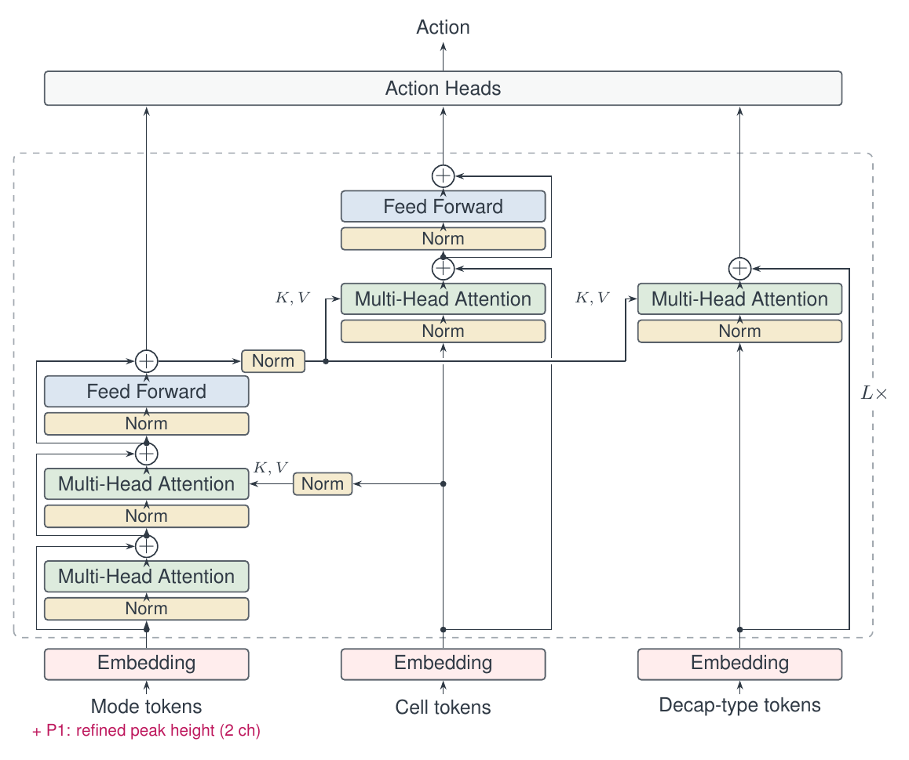
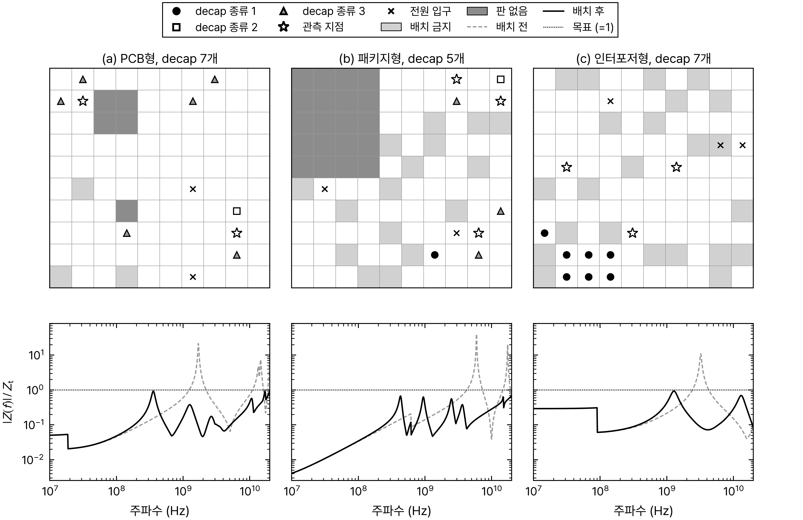
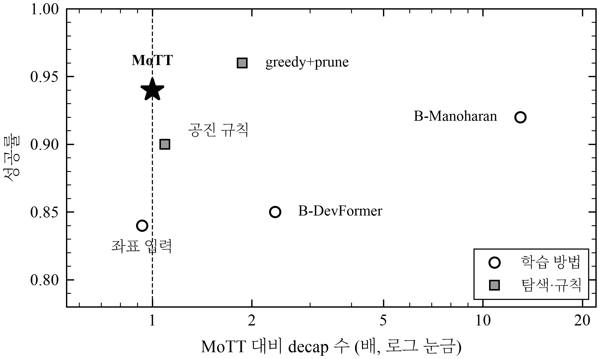
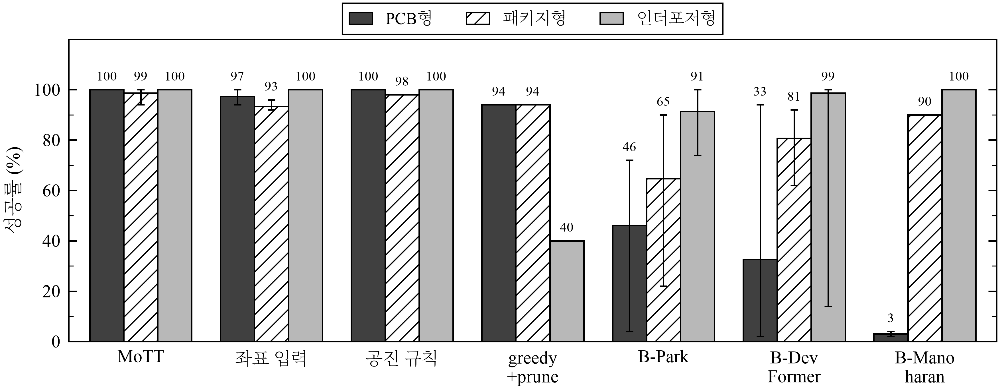
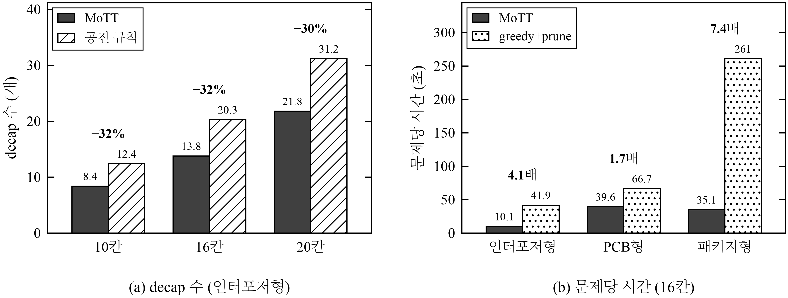

<div align="center">

# MoTT: Modal-Token Transformer

A Modal-Token Transformer for Generalizable Decoupling Capacitor Placement

[한국어](README.md) | English



</div>

## Introduction

A power distribution network (PDN) resonates at certain frequencies, where its impedance rises. Decoupling capacitors (decaps) placed at the right cells lower these peaks, but the number of ways to choose cells and decap types is far too large to enumerate.

Prior reinforcement-learning methods decide the placement quickly, but mostly take cell coordinates as input, and a policy trained this way has to be retrained when the kind of board (PCB, package, interposer) changes. MoTT describes a board with resonant-mode tokens, cell tokens and decap-type tokens instead of coordinates, so that one policy can be used on board kinds and sizes it has not seen in training.

This repository contains the simulator, the model and training code, the baselines, and the evaluation records behind every number in the report.

<div align="center">


Placements by MoTT on the three board kinds (10×10). Bottom: impedance before (dashed) and after (solid).
</div>

## How to check the numbers

| What to check | Where |
|:--|:--|
| Where a number in a table comes from | evaluation records in [`runs/`](runs) ([format](runs/README.md), [full tables](docs/RESULTS.md)) |
| Whether the decision rule came before the result | [pre-registration timeline](docs/PREREGISTRATION.md) (rule commit and first-result commit per experiment) |
| The decision rules themselves | [docs/PROPOSALS.md](docs/PROPOSALS.md) |
| The full record before cleanup | [`research-log`](../../tree/research-log) branch, [`experiments-final`](../../tree/experiments-final) tag |

The **Records** line at the end of each experiment links to its folders and commits.

## Experiments and results

Success rate is the fraction of problems that pass the exact check (700 frequency points plus refinement around peaks). Unless noted: 10×10 boards, 3 seeds × 50 problems. All methods are evaluated on the same problems with the same check.

### 1. Input analysis: which inputs carry over to another kind of board

Before training, we measured by AUC whether an input that separates good cells on one kind of board still does so on another (0.5 is chance).

| Input | PCB → PCB | PCB → interposer | Interposer → PCB |
|:--|:-:|:-:|:-:|
| Distance to the probe | 0.74 | 0.46 | 0.23 |
| Loop inductance + fixed-frequency impedance | 0.88 | 0.45 | 0.59 |
| Effect of placing one decap | 0.73 | 0.98 | 0.74 |
| Resonance features | 0.86 | 0.59 | 0.32 |

Inputs used in prior work fall below chance when the kind of board changes. The model therefore uses the exact one-step effect as its base score and resonance features only as a correction.

> **Records** the analysis code and results are on the [`research-log` branch](../../tree/research-log/research_notes/%ED%86%A0%ED%81%B0%20%EB%8D%B0%EC%9D%B4%ED%84%B0%20%EB%B6%84%EC%84%9D).

### 2. Unseen kind of board

One of the three kinds is removed from training and used only for evaluation.

| Held-out kind | MoTT | Coordinate input |
|:--|:-:|:-:|
| PCB | 0.89 | 0.64 |
| Interposer | 0.99 | 0.65 |
| Package | 0.71 | 0.80 |
| Package + verification harness | 0.99 | 0.92 |

The policy alone is below the coordinate model on the held-out package boards. The cause was peaks hidden between the 32 frequencies used for decisions. With the verification harness, which finds the failing frequency by the exact check and lets the policy fix the placement, 43 of the 44 failed problems were solved without adding decaps.

The same harness applied to the re-implemented prior methods (trained without package boards):

| Method | Package (held out) | PCB | Interposer | Decaps relative to MoTT |
|:--|:-:|:-:|:-:|:-:|
| MoTT | 0.99 | 0.99 | 1.00 | – |
| Coordinate input | 0.92 | 0.94 | 1.00 | 1.0× |
| B-Park | 0.91 | 0.04 | 1.00 | 2.8× |
| B-DevFormer | 0.45 | 0.79 | 0.99 | 4.5× |
| B-Manoharan | 0.89 | 0.03 | 1.00 | 4.3× |

> **Records** under [`runs/2026-10-29/`](runs/2026-10-29), `lo_<kind>_r2pk*_rl` (MoTT), `lo_<kind>_r0*_rl` (coordinate input), `lo_pkg_bp_park*`, `lo_pkg_bdf*`, `lo_pkg_bm2_rlonly*` (re-implementations). Harness results are the files ending in `+rep4`. · Decision rules: F1 [`ed4ced5`](https://github.com/jeehoo0507/R2E/commit/ed4ced5), N [`ce4422f`](https://github.com/jeehoo0507/R2E/commit/ce4422f), package harness (added after seeing results) [`451ec4d`](https://github.com/jeehoo0507/R2E/commit/451ec4d)

### 3. Unseen board size

Models trained on 8–12 cell boards are evaluated on 16×16 and 20×20.

| Size | Kind | Policy | + harness |
|:--|:--|:-:|:-:|
| 16×16 | Interposer | 1.00 | 1.00 |
| | PCB | 0.92 | 0.99 |
| | Package | 0.56 | 0.94 |
| 20×20 | Interposer | 1.00 | 1.00 |
| | PCB | 0.92 | 1.00 |
| | Package | 0.50 | 0.96 |

<div align="center">


Success rate and decap count on 16×16 package boards, the hardest case (with harness).
</div>

> **Records** under [`runs/2026-10-29/`](runs/2026-10-29), `r2pk*_rl/eval/eval_<kind>16_*` and `eval_<kind>20_*` · Decision rule: F [`0242e56`](https://github.com/jeehoo0507/R2E/commit/0242e56)

### 4. Effect of the input and of the architecture

| Model | Input | Architecture | Unseen PCB | Unseen interposer | Decaps (interposer 10 / 16) |
|:--|:--|:--|:-:|:-:|:-:|
| Coordinate input | coordinates | baseline | 0.64 | 0.65 | 11.2 / 20.6 |
| Resonance input | coordinates + resonance | baseline | 0.84 | 0.89 | 9.8 / 17.9 |
| MoTT (no P1) | resonance | MoTT | 0.90 | 0.89 | 8.0 / 14.6 |
| MoTT | resonance + P1 | MoTT | 0.89 | 0.99 | 8.0 / 13.9 |

Adding resonance features raises the success rate on unseen kinds; changing the architecture to MoTT lowers the decap count.

> **Records** `r0_coord*` (coordinate input), `r1_modal*` (resonance input), `r2_mott*` (no P1), `r2pk*` (MoTT) and their `lo_<kind>_*` runs · Decision rule: P1 [`4b496a5`](https://github.com/jeehoo0507/R2E/commit/4b496a5)

### 5. Trained on all three kinds

<div align="center">

</div>

MoTT is the only learned method at or above 0.99 on all three kinds. The re-implemented prior methods drop to 0.02 on PCB boards for some seeds.

> **Records** under [`runs/2026-10-29/`](runs/2026-10-29), `r2pk*`, `r0_coord*`, `bp_park*`, `bdf*`, `bm2_rlonly*` · Decision rules: B1 [`e70de68`](https://github.com/jeehoo0507/R2E/commit/e70de68), N [`ce4422f`](https://github.com/jeehoo0507/R2E/commit/ce4422f)

### 6. Decap count and speed

<div align="center">

</div>

On interposer boards MoTT uses about 30% fewer decaps than the resonance rule (8.4 / 13.8 / 21.8 at 10 / 16 / 20 cells, against 12.4 / 20.3 / 31.2).

Speed was measured three times on different problem sets. Total time of greedy+prune divided by that of MoTT with the harness:

| Measurement | Interposer | PCB | Package |
|:--|:-:|:-:|:-:|
| 1 (50 problems) | 4.1× | 1.7× | 7.4× |
| 2 (150 problems) | 4.4× | 1.4× | 4.3× |
| 3 (150 problems, another server) | 3.9× | 1.7× | 6.0× |

Records of measurements 1 and 2 are under `runs/speed_*`. Records of measurement 3 (server 2) will be added.

> **Records** [`runs/speed_1109u/`](runs/speed_1109u), `runs/speed_1110v_*/` · Conditions: 11/09 U and 11/10 V in [docs/PROPOSALS.md](docs/PROPOSALS.md)

## Usage

```bash
pip install -r requirements.txt
python sanity_check.py                                  # simulator and exact check

python scripts/build_pools.py --out runs/pool_v1        # problems from fixed seeds
python scripts/make_teacher.py --pool runs/pool_v1 --out data/teacher

# training: imitation 0.75 h, then reinforcement learning 1.25 h
python scripts/run_rung.py --name r2pk --arm "--model mott --peak_refine" \
    --distill_hours 0.75 --rl_hours 1.25 --seed 0

# evaluation: --repair 4 turns on the verification harness
python scripts/eval_policy.py --pool runs/pool_v1 --sets 'eval_*' \
    --policy mott=runs/<day>/r2pk_rl/best.pt --repair 4 --out runs/<day>/r2pk_rl
```

## Repository layout

| Path | Contents |
|:--|:--|
| `decap_loop/` | PDN simulator, exact check, MoTT model, search baselines |
| `baselines_ml/` | re-implementations of prior work (B-Park, B-DevFormer, B-Manoharan) |
| `train.py`, `scripts/` | training, problem generation, evaluation, result tables, speed measurement |
| `runs/` | evaluation records behind every number above ([format](runs/README.md)) |
| `docs/` | decision rules, pre-registration timeline, result tables, agent operation |

## Prior work compared

Methods named B- are re-implementations that carry the architecture and inputs of the papers below into this repository's problem setting. The problem setting and the training budget (2 h) differ from the papers, so they are not reproductions of the original results.

- Park et al., "Transformer network-based reinforcement learning method for PDN optimization of HBM," IEEE T-MTT, 2022. [doi](https://doi.org/10.1109/TMTT.2022.3202221)
- Kim et al., "DevFormer: A symmetric transformer for context-aware device placement," ICML, 2023. [paper](https://proceedings.mlr.press/v202/kim23h.html)
- Manoharan et al., "Reinforcement learning for decoupling capacitor optimization in postlayout PDNs using transformer architecture," IEEE T-SIPI, 2026. [doi](https://doi.org/10.1109/TSIPI.2026.3691276)

## Limitations

Synthetic boards only, up to 20×20 cells and three decap types per kind.
